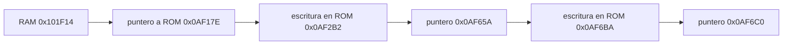

# Primer soldado de Misión 1: evidencia y límites

Se usaron **el debugger de MAME 0.276** (`wpset`, `bpset`, `trace` a fichero),
Lua para guardar RAM en cada fotograma y **Ghidra 11.4.2 headless**. El informe
estructurado es [first-soldier-evidence.json](first-soldier-evidence.json).
Las conclusiones siguientes corresponden a `mslugx`, BIOS `euro` y la partida
reproducible descrita aquí; las direcciones de un slot no son una identidad
universal de todos los soldados.

## VERIFICADO

| Dato | Dirección / valor | Evidencia |
| --- | --- | --- |
| Slot del primer soldado de esta partida | RAM `0x101F14` | Watchpoint en la cabecera, traza con A6 igual al slot y correspondencia gráfica |
| Entrada inicial asignada | ROM `0x0AF17E` | Escritura del puntero y ejecución posterior por despacho indirecto |
| Siguiente entrada asignada | ROM `0x0AF65A` | `MOVE.L #0x0AF65A,(A6)` en ROM `0x0AF2B2`, ejecutado en la traza |
| Estado siguiente observado | ROM `0x0AF6C0` | `MOVE.L #0x0AF6C0,(A6)` en ROM `0x0AF6BA`, ejecutado en la traza |
| Lectura del puntero actual | ROM `0x004246` | `MOVEA.L (A6),A0`, en traza y Ghidra |
| Llamada a la rutina | ROM `0x004248` | `JSR (A0)`, con A6=`0x101F14` y A0=`0x0AF17E`, en la traza |
| Enlaces del nodo | `+0x04` previo, `+0x08` siguiente, `+0x0C` padre | Instrucciones del asignador ROM `0x0040BC` y escrituras observadas en el slot |
| Recorrido al nodo siguiente | ROM `0x00424A` | Lee `+0x08` desde A6 después de la llamada |
| Palabras globales del asignador | RAM `0x1063D4`, `0x1063D8` | Referencias en el desensamblado Ghidra de `0x0040BC`; no establecen el tamaño total del pool |

La estructura observada se recorre mediante enlaces. **No se presupone una
matriz de actores con un tamaño o número de entradas inventado.** La longitud
`0x10` del watchpoint es la cabecera vigilada, no el tamaño del actor.



### Tiempo y trazas

Se guardaron **361 volcados consecutivos**, `ram2100.bin` a `ram2460.bin`, de
64 KiB cada uno. No se parchearon salud, munición, colisiones ni variables de
IA. El Lua usa entradas del mando y variables auxiliares del debugger. Para
leer VRAM selecciona su dirección mediante el puerto gráfico; no convierte
VRAM en una región CPU ficticia.

`temp9` contiene el último fotograma terminado. La escritura registrada con
`temp9=2351` se observa por primera vez en `ram2352.bin`. No se confunden el
contador del callback, el PC mostrado durante un watchpoint y la dirección de
la instrucción que realiza la escritura. Por ejemplo, el watchpoint informa
PC=`0x0AF2BA`; la instrucción ejecutada que escribe el puntero empieza en
`0x0AF2B2`, comprobada por la traza y Ghidra.

La secuencia completa de punteros observados en RAM está en el JSON, con el
primer fotograma de cada valor. Los nombres funcionales de esos estados no se
asignan solo por mirar sus direcciones.

### Identidad gráfica y movimiento

El slot se ha relacionado con los SCB/C-ROM, no solo con una paleta:

- Fotograma 2380: descriptor físico ROM `0x16043C`, cinco celdas SCB y 536
  píxeles opacos coincidentes con MAME.
- Fotograma 2400: descriptor físico ROM `0x1603B4`, cinco celdas SCB y 522
  píxeles opacos coincidentes con MAME.

La tolerancia RGB es de uno por canal por la conversión de resistencias de
Neo Geo. Se verifican también posición y código de las celdas. Hay **43
cambios de X** en los que el incremento de la posición coincide exactamente
con el valor almacenado en `+0x30`.

La RAM y la presentación no son la misma fase: en el fotograma 2380, el
puntero en `+0x20` vale `0x23D566`, mientras el dibujo corresponde a la entrada
`0x23D55C`. El verificador busca la coincidencia de las celdas reales y usa los
campos de coordenadas conservados en `+0x44/+0x48` y la corrección de `+0x4D`.
No se deduce el dibujo mostrado restando una longitud fija al puntero actual.

## Fragmento nativo comprobado

La primera recuperación de `src/neo_soldier.c` traduce la aritmética observada en
`0x0AF65A`, manteniendo nombres neutrales para los campos `+0x62` y `+0x26`.
No implementa una IA completa ni sustituye el generador original por `rand()`.
El seguimiento posterior recupera el RNG original, dos inicializaciones y
bloques adicionales de decisión/desaceleración; sus pruebas independientes
en host y ares están en [SOLDIER_RNG.md](SOLDIER_RNG.md).

| Operación | ROM |
| --- | --- |
| Extender el primer resultado de RNG de 16 a 32 bits | `0x0AF670` |
| Extender el segundo resultado | `0x0AF67C` |
| Sumar `0x28000` | `0x0AF67E` |
| Sumar el primer resultado guardado | `0x0AF684` |
| Comprobar `+0x92` y añadir `0x10000` si no es cero | `0x0AF688`–`0x0AF690` |
| Signo según bit 0 de `+0x15` | `0x0AF696`–`0x0AF6A0` |
| Escribir la palabra de 32 bits en `+0x62` | `0x0AF6A2` |
| Desplazar seis bits, intercambiar mitades y sumar `0x80` | `0x0AF6AE`–`0x0AF6B2` |
| Escribir la palabra de 16 bits en `+0x26` | `0x0AF6B6` |

La prueba usa valores **medidos**, no elegidos para producir el resultado:
RNG `0x5589` y `0x23BA`, campo `+0x15=0x40`, campo `+0x92=0`, salida
`+0x62=0xFFFD06BD` y `+0x26=0x013E`. El fixture incluye el hash de la traza en
[data/first_soldier_init_fixture.json](../data/first_soldier_init_fixture.json).
El caso observado pasa en C del host y el módulo compila con GCC MIPS.
La rama `+0x92!=0` está desensamblada; no ha sido ejercitada por esta captura.

## SUPUESTO / NO VERIFICADO TODAVÍA

- El nombre funcional y todas las condiciones de los estados posteriores:
  perseguir, atacar, lanzar o morir requieren pruebas de entradas/impactos.
- Los límites completos del pool, su número de entradas y un stride universal.
- La salud de este soldado y su tabla de dificultad. En las muestras permanece
  activo con `+0x4E=0`: no se traslada automáticamente a esta clase el campo de
  vida observado en el vehículo.
- El orden global de llamadas al RNG en el juego nativo, los temporizadores,
  todas las ramas de CCR/carry y la IA íntegra. El RNG recuperado tiene un
  contexto C separado; esto no establece el orden de ejecución de todos los actores.
- Los tipos, parámetros y expresiones C propuestos por el decompilador. Sus
  archivos se llaman `TENTATIVE_*.c`; no son código nativo validado.

Los encuentros de tres guardias de `gameplay.c` conservan valores de desarrollo
propios —posiciones, dos impactos de vida, cadencia y checkpoint—. Están
marcados como **PROVISIONALES**, no como lógica recuperada del 68000. Este
trabajo no los presenta como IA original ni los reemplaza por hipótesis nuevas.

## Ghidra y mapa Neo Geo usado

El proyecto importa el bloque CPU fijo capturado `0x000000..0x0FFFFF`, RAM
`0x100000..0x10FFFF`, ventana bancaria CPU `0x200000..0x2FFFFF`, BIOS
`0xC00000..0xC1FFFF`, paleta y registros de E/S documentados por el driver MAME
0.276. Las regiones de E/S son volátiles. No se confunde el puerto VRAM con
RAM direccionable directamente por CPU.

La comparación con las ROM propias verifica que el bloque fijo coincide con
P1 tras el intercambio de bytes por palabra. La ventana CPU capturada en el
fotograma 2360 coincide con el **banco físico 2**. El banco físico 1 se añade
como **overlay separado** para los descriptores gráficos: no se mapea encima
de la RAM CPU. No se generaliza esa selección de banco a toda la partida ni
se da por completo el modelado de aliases/protección.

La distribución instalada ofrece el lenguaje `68000:BE:32:MC68020`, un
superset de la familia 68000; no incluye una variante estricta MC68000.
**No se oculta esa diferencia.** Los opcodes ejecutados se contrastan con la
traza del M68000 real de MAME; no se considera verificado un camino solo
porque Ghidra consiga desensamblarlo o decompilarlo.

Ghidra y el JDK se descargaron de sus proyectos oficiales y se verificaron
sus SHA-256 antes de extraerlos. Versiones y hashes están en
[data/reverse-toolchain.json](../data/reverse-toolchain.json).

## Reproducir

Con ROMs propias, MAME 0.276, Xvfb, Ghidra 11.4.2 y JDK 21:

```sh
python3 tools/mame/run_first_soldier.py \
  --rom-dir /ruta/roms --output /ruta/nueva-captura
python3 tools/ghidra/prepare_neogeo_inputs.py /ruta/mslugx.zip /ruta/nueva-captura
python3 tools/ghidra/run_first_soldier.py /ruta/nueva-captura \
  --ghidra /ruta/ghidra_11.4.2_PUBLIC --jdk /ruta/jdk21 \
  --output /ruta/nuevo-proyecto-ghidra
python3 tools/verify_first_soldier.py /ruta/nueva-captura \
  /ruta/nuevo-proyecto-ghidra --output build/first-soldier-evidence.json \
  --fixture build/first-soldier-init-fixture.json
make check
make build/src/neo_soldier.o
```

El script de captura vigila el slot ya descubierto para este set y esta
partida; no es un detector universal de actores. Las salidas deben ser nuevas
para conservar la evidencia anterior. `-debugger none` selecciona el frontend
sin GUI; **`-debug` mantiene activo el debugger** y Lua ejecuta sus comandos.
La traza queda limitada a la ventana inicial de creación/actualización.

Las pruebas locales definitivas están en
`/workspace/research/soldier-debug-v3` y `/workspace/research/soldier-ghidra-v3`.
Los intentos anteriores con un formato de consola incorrecto no se usan como
evidencia. RAM, ROM, BIOS, trazas completas y proyectos Ghidra se mantienen
locales; en GitHub se guardan scripts, hashes y resultados sanitizados.
Este paso no modifica la IA activa ni publica una demo.
