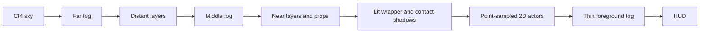

# Optional N64 depth lighting mode — internal development

This is a separate visual mode for the native port. It does not complete the
game or replace its 2D collision/animation logic. No new demo ROM is published;
the next game delivery remains reserved for a complete-port beta.

## Depth and normal assets

Authoring is in `data/retro_surfaces.json`. Depth is authored explicitly for
background planes and low-poly wall/roof wrappers. The terrain follows the
recovered ground profile. Colours in the original artwork are never interpreted
as height: dark outlines and painted shadows are not reliable geometry.

`tools/retro_geometry.py` is the offline analytic depth field. It generates the
same terrain lookup and plane derivatives used by N64 vertex lighting.

```sh
python3 tools/build_retro_assets.py
python3 tools/export_depth_maps.py --camera 0
python3 tools/export_depth_maps.py --camera 460
```

Technical examples are in [retro25d-maps](retro25d-maps/). These are authoring
maps, not screenshots of a completed game:

- Depth: unsigned 16-bit PNG, `z = -8 + sample/65535 * 520`, increasing away
  from the camera. The far backdrop is 512 units away.
- Normals: RGB8 data, `N = RGB/255 * 2 - 1`; X right, Y down, +Z towards the
  viewer. Treat as linear data, not sRGB colour.
- Terrain/structure depth in these assets is a new art direction, not a claim
  that Neo Geo supplied a depth buffer or original normal maps.

The RDP cannot evaluate a modern per-pixel normal-map shader. At runtime the
R4300i samples the analytic normals at mesh vertices and evaluates diffuse and
point-light terms. RDP Gouraud interpolation shades the wrapper. The PNG normal
map is not sampled by the GPU, and there is no normal/depth framebuffer pass.
This is deliberately normal-guided vertex lighting, not per-pixel normal mapping.

## Projection and pixel art

The camera uses an actual pinhole projection:

```
scale = focal / (focal + z - camera_z)
screen_x = 160 + (world_x - camera_x - 160) * scale
screen_y = 120 + (world_y - camera_y - 120) * scale
```

Focal distance is 320. Billboard coordinates are authored to retain their pixel
size in the reference view. The layer depths 320 and 106.6667 produce the
original 1/2 and 3/4 parallax rates at camera_z=0. For a constant-depth plane,
the exact perspective expression reduces to a cached scale and translation;
it is computed once per plane, not divided per tile. The mesh uses the full
projection with varying vertex Z. Geometry stays well clear of the near plane.

Character/vehicle images use the existing CI4/RGBA5551 sprite path. It explicitly
sets `FILTER_POINT` before every sprite draw. Gameplay positions and collision
remain 2D; sprites are not warped by the mesh. Foreground fog can tint pixels,
but does not blur or bilinearly sample the character artwork. VI continues
using the working RESAMPLE configuration at 320x240; CRT/output scaling remains
separate from texture filtering.

## Mesh, lights and shadows

- Ground: eight coarse segments, one depth strip, 16 triangles.
- Four authored static wrappers: 2x2 quads each, at most 32 triangles total.
- Two contact shadows: eight-triangle feathered fans each, at most 16 triangles.
- Configured worst case: **64 triangles**, with an enforced **96-triangle cap**.
- Two point lights, with normal-facing diffuse response and bounded quadratic
  attenuation. Current hooks are muzzle flash and enemy hit/defeat flash.
  The same API accepts a future grenade/explosion event; explosion animation
  and complete weapon logic are not implemented by this feature.

The wrapper is a shaded lighting overlay registered to the original artwork;
it does not replace every background tile with a textured 3D polygon. Contact
shadows are approximate blobs, not dynamic shadow maps or full building/vehicle
occlusion. The shadow API accepts a footprint radius for larger objects.

Original ambient shading stays baked in the artwork. Wrapper triangles with no
dynamic-light contribution are culled; there is no extra full-ground blending
pass in an unlit scene. Terrain heights are compiled at eight-pixel intervals into a small lookup. Shared
mesh vertices and cached plane transforms avoid repeated collision scans and
per-tile perspective divisions on the CPU. Triangle setup uses libdragon's
RSP-backed rdpq path, not Fast3D geometry or a desktop GLSL shader.

## Fog and pass ordering

Fog is three depth-sorted density sheets, a low-cost approximation of volume.
There is no ray marching, bloom, screen-space blur or modern post-processing.
One 32x32 IA8 noise texture (1024 bytes) is reused with three uploads per frame.
The fog sampler alone uses N64 bilinear filtering. Edges are feathered in the
texture; sheets drift at different rates and receive a small point-light tint.



The sprite/background upload path retains its <=2048-byte assertion; CI4 leaves
the other 2048 bytes for TLUT. Fog uses 1024 bytes with TLUT disabled. It restores
the previous combiner/filter/blender state and invalidates the tracked texture
residency before subsequent sprite uploads. There is no extra Z buffer or
full-screen depth/normal render target.

## Internal build and validation

```sh
python3 -m pip install -r requirements-tools.txt
make check
make -j4 MSX_VISUAL_MODE=depth25d
# Preserve this test binary outside downloads/; do not publish it as a demo.
# Return to the original visual path:
make -j4 MSX_VISUAL_MODE=classic
```

The generated visual_config.h changes only when the selected mode changes,
forcing the dependent actor object to rebuild. Merely changing CFLAGS without
recompiling an object is not used to switch modes.

Host tests cover projection/parallax equivalence, forward-camera perspective,
near-plane rejection, unit normals, normal/light orientation, distance falloff,
normalised RDP colours and geometry budgets. Existing gameplay, original motion,
codec and clock regressions remain in make check.

The ares test uses `tools/test_mission_ares.py --version 10 --variant retro25d`
and an internal binary. It checks the light hook, triangle/TMEM assertions,
camera traversal, jumping/landing, combat, restart and return from the laboratory.
Tests are against the existing partial gameplay scene, not a complete campaign.
Emulated submission timings are diagnostic; this is not a guarantee of full
frame rate on N64/MiSTer or in the eventual complete game.
