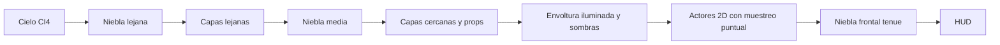

# Modo visual 2.5D (`depth25d`, activo por defecto)

El port compila por defecto el modo `depth25d`: cambios sutiles en tres
dimensiones sobre el arte original. El pixel art, las animaciones, la colisión
y la jugabilidad 2D no cambian. La profundidad se añade con paralaje y
perspectiva, iluminación por vértice, sombras de contacto y niebla; nunca
deformando, filtrando ni repintando los sprites. No completa el juego ni
sustituye la lógica 2D; no se publica una nueva demo por este cambio.

```sh
make -j4                              # depth25d (por defecto)
make -j4 MSX_VISUAL_MODE=classic      # ruta plana original
```

`build/visual_config.h` solo cambia cuando cambia el modo elegido, y así fuerza
a recompilar el objeto dependiente (`actor.o`). No se cambia de modo alterando
CFLAGS sin recompilar.

Las capas 2/3/4 (terreno a velocidad completa y props) mantienen la misma
proyección 2D que los actores y las colisiones. Solo las capas lejanas 0/1
aplican paralaje en perspectiva. Dar profundidad 8 a la capa 2 introducía
21,27 píxeles de deriva horizontal con cámara 872; el relieve de iluminación
puede tener profundidad sin desplazar los texeles del suelo jugable.
`retro_background_projection` conserva esa alineación aunque se cambie una
profundidad de autoría. La prueba host barre cámaras 0..1920.

Los paneles de diagnóstico se muestran/ocultan con **L** y arrancan ocultos.
No son el HUD arcade original, que sigue pendiente. El aviso «REGION END»
permanece visible al alcanzar el límite provisional.

## Mapas de profundidad y normales

La autoría está en `data/retro_surfaces.json`. La profundidad se define de forma
explícita para los planos de fondo y para envolturas low-poly de muros y tejados.
El terreno sigue el perfil de suelo recuperado. Los colores del arte original
nunca se interpretan como altura: los contornos oscuros y las sombras pintadas
no son geometría fiable.

`tools/retro_geometry.py` es el campo de profundidad analítico offline. Genera
la misma tabla de terreno y las mismas derivadas de plano que usa la
iluminación por vértice en N64.

```sh
python3 tools/build_retro_assets.py
python3 tools/export_depth_maps.py --camera 0
python3 tools/export_depth_maps.py --camera 460
```

Los ejemplos técnicos están en [retro25d-maps](retro25d-maps/). Son mapas de
autoría, no capturas de un juego terminado:

- Profundidad: PNG de 16 bits sin signo, `z = -8 + muestra/65535 * 520`,
  creciente al alejarse de la cámara. El fondo lejano está a 512 unidades.
- Normales: datos RGB8, `N = RGB/255 * 2 - 1`; X a la derecha, Y hacia abajo,
  +Z hacia el espectador. Son datos lineales, no color sRGB.
- La profundidad de terreno y estructuras es una dirección artística nueva; no
  se afirma que la Neo Geo tuviera Z-buffer ni normal maps originales.

El RDP no puede evaluar un shader moderno de normal map por píxel. En tiempo
de ejecución el R4300i muestrea las normales analíticas en los vértices de la
malla y evalúa los términos difuso y de luz puntual. La interpolación Gouraud
del RDP sombrea la envoltura. El PNG de normales no lo muestrea la GPU y no hay
pasada de framebuffer de normales/profundidad. Es iluminación por vértice guiada
por normales, no normal mapping por píxel.

## Proyección y pixel art

La cámara usa una proyección pinhole real:

```
scale = focal / (focal + z - camera_z)
screen_x = 160 + (world_x - camera_x - 160) * scale
screen_y = 120 + (world_y - camera_y - 120) * scale
```

La distancia focal es 320. Las coordenadas de billboard se autorizan para
conservar su tamaño en píxeles en la vista de referencia. Las profundidades
actuales 960 y 320 dan velocidades de paralaje 1/4 y 1/2 con `camera_z=0`,
acentuando la separación de los fondos. La configuración anterior (320 y
106,6667) reproducía las velocidades originales 1/2 y 3/4 y resultaba demasiado
plana para la dirección de diorama solicitada. Este ajuste es artístico, no
una profundidad recuperada de la ROM. Para un plano de profundidad constante la expresión se reduce a
escala y traslación cacheadas por plano, sin divisiones por tile. La malla usa
la proyección completa con Z variable por vértice y queda lejos del plano
cercano.

Personajes y vehículo usan la ruta de sprites CI4/RGBA5551 existente, que fija
`FILTER_POINT` antes de cada dibujo. Posiciones y colisión siguen siendo 2D; la
malla no deforma sprites. La niebla frontal puede teñir píxeles, pero no
desenfoca ni muestrea con bilineal el arte de los personajes. El VI mantiene
`FILTERS_RESAMPLE` a 320x240; el escalado CRT/salida es independiente del
filtrado de texturas.

## Malla, luces y sombras

| Elemento | Triángulos |
| --- | ---: |
| Suelo: 8 segmentos, una tira de profundidad | 16 |
| Planos visibles (máx. 5, 2x2 quads cada uno) | 40 |
| Sombras de contacto (máx. 4 abanicos de 8) | 32 |
| **Peor caso configurado** | **88** |
| Límite impuesto (`assertf` y `retro_build_mesh`) | 96 |

Medido en host con `tools/test_retro25d.c`, recorriendo cada posición de cámara
con dos luces que iluminan toda la pantalla y cuatro sombras: **80/96** en el
nivel autorizado actual (4 planos a la vez como máximo) y **88/96** en un nivel
sintético de 4000 px con 40 planos.

- Dos luces puntuales con respuesta difusa según la normal y atenuación
  cuadrática acotada. Si llega una tercera, `retro_frame_add_light()` sustituye
  a la más débil solo si la nueva es más intensa.
- Fuentes actuales: fogonazo del disparo, destello del enemigo alcanzado y
  **pulsos breves** (`retro_pulse_t`): impacto de bala (6 ticks, radio 30–36),
  inicio de la destrucción del blindado (14 ticks) y su explosión (30 ticks,
  radio 150). La intensidad decae como `(1-t)^2` y el radio se abre del 75 % al
  100 %.
- Sombras de contacto: abanicos de ocho triángulos con centro oscuro (25/255)
  y borde transparente, apoyados en la franja de suelo que retrocede. En el aire
  la sombra se aclara y encoge hasta un 25 %; desaparece a más de 96 px.
  El blindado usa una huella de 54 px con elipse aplanada (0,14).

La envoltura es una capa de iluminación registrada sobre el arte original; no
sustituye cada tile del fondo por un polígono texturizado. Las sombras son
manchas aproximadas, no shadow maps ni oclusión completa de edificios o
vehículos. Los triángulos sin aportación de luz dinámica se descartan: en una
escena sin luces no hay pasada de mezcla sobre el suelo. La sombra ambiental
original sigue pintada en el arte. Alturas de terreno cada ocho píxeles,
vértices compartidos y transformaciones de plano cacheadas evitan recorrer la
colisión y dividir por tile en la CPU. Los triángulos se envían por rdpq (RSP),
no por Fast3D ni shaders GLSL.

### API para actores

`src/retro25d.h` expone funciones C puras (probadas en host):

```c
retro_shadow_t retro_actor_shadow(float world_x,float feet_y,float ground_y,float half_width);
bool retro_frame_add_shadow(retro_frame_t *frame,retro_shadow_t shadow);
bool retro_frame_add_light(retro_frame_t *frame,retro_light_t light);
```

Para enganchar un soldado basta, dentro del bloque `#if MSX_RETRO25D` de
`actor_draw()` y antes de `retro_events_frame()`:

```c
retro_frame_add_shadow(&effects,retro_actor_shadow(x,pies_y,suelo_y,10));
```

`world_x` es X de mundo; `feet_y`/`ground_y` son Y de pantalla (hacia abajo).
Con cuatro sombras ya presentes la llamada devuelve `false` y no dibuja nada
más; el orden de llamada es la prioridad (jugador, enemigo cercano,
blindado...).

`src/retro_events.c` es un observador de solo lectura de `msx_game_t`: añade
la sombra del blindado, detecta balas que desaparecen dentro de la pantalla
(impacto contra suelo, enemigo o blindado; las que salen de pantalla no cuentan)
y los flags de destrucción/explosión del blindado, y gestiona los pulsos. Un
reinicio, el traspaso de la misión o una reaparición no generan pulsos falsos.
No escribe en la jugabilidad, la colisión ni los sprites.

## Niebla y orden de pasadas

La niebla son tres láminas de densidad ordenadas por profundidad, una
aproximación barata al volumen. No hay ray marching, bloom, desenfoque en
pantalla ni postproceso moderno. Una textura de ruido IA8 de 32x32 (1024 bytes)
se reutiliza con tres subidas por frame. Solo el muestreo de la niebla usa
filtrado bilineal. Los bordes están difuminados en la textura; las láminas se
desplazan a ritmos distintos y reciben un ligero tinte de las luces.

**Enfoque de cámara** (`retro_frame_t.focus`): mientras la cámara se desplaza,
la lámina lejana gana hasta 4/255 de opacidad y la intermedia 2/255; al parar
vuelve suavemente al valor original. Es un efecto tipo profundidad de campo
sin pasadas extra. La lámina frontal, la única que cubre sprites, no cambia.



La subida de sprites/fondo mantiene su aserción de <=2048 bytes; CI4 deja los
otros 2048 bytes para TLUT. La niebla usa 1024 bytes con TLUT desactivada.
Restaura combiner/filtro/blender con `rdpq_mode_push/pop`, repone el scissor e
invalida la residencia de textura y paletas antes de las siguientes subidas.
La malla usa solo color de sombreado: no toca TMEM ni TLUT. No hay Z-buffer
extra ni render targets de profundidad o normales.

## Rutas del cartucho por defecto

- **Juego** (`mslugx-explorer.z64`): fondo con paralaje en perspectiva,
  niebla, envoltura, sombras y pulsos. `scene_render_begin()` parte siempre de
  un estado conocido: modo estándar, scissor completo, muestreo puntual y sin
  residencia de TMEM/TLUT supuesta.
- **Laboratorio gráfico** (Start): dibuja con la CPU, sin rdpq. Al volver, el
  primer frame reinicia el estado como arriba; el reloj de simulación se
  reinicia y el observador de efectos no genera pulsos.
- **Entrada en paracaídas** (`mission1-internal.z64`, véase
  [MISSION_ENTRY.md](MISSION_ENTRY.md)): la secuencia es un flujo de
  framebuffers RGBA5551 con CRC y no recibe efectos 2.5D, así que sus 230 CRC
  no cambian. `rdpq_tex_blit` sobrescribe TMEM y deja su propio modo; el
  traspaso llama a `scene_render_forget_texture()` y el primer frame de juego
  restablece modo y scissor. El reinicio de `ticks` en el traspaso descarta
  pulsos previos.
- **Texto/HUD**: las fuentes pueden reemplazar TMEM; `scene_render_text()`
  invalida la residencia.

## Añadir superficies

Otro trabajo amplía el nivel más allá de la cámara 872. Para añadir relieve:

1. Añadir un objeto a `planes` en `data/retro_surfaces.json`:
   `{"name":"pared_x","rect":[izq,arriba,der,abajo],"depth":3,"dx":0.02,"dy":0.005}`.
   `rect` usa X de mundo e Y de pantalla. Se admite cualquier X: el runtime
   descarta los planos fuera de `[camera_x-32, camera_x+352]`.
2. Reglas que comprueba `tools/build_retro_assets.py`: nombre único,
   `izq<der`, `arriba<abajo<=240`, profundidad entre -6 y 24 en las cuatro
   esquinas, `|dx|,|dy|<=0,25` y **como máximo 5 planos solapando una ventana
   de cámara de 384 px**. El script ordena los planos por borde izquierdo
   (el runtime corta el recorrido en el primero fuera de vista) y genera
   `RETRO_PLANE_COUNT` y `RETRO_MAX_PLANES_IN_VIEW`.
3. El perfil de suelo sale de `filesystem/mission1/collision.json`; al ampliar
   la rejilla de colisión, `RETRO_GROUND_WIDTH` y la tabla crecen solos.
4. Comprobar con `make check` (mide el peor caso del nivel real),
   `python3 tools/export_depth_maps.py --camera N` y `make preview-depth`.

Elegir `dx` positivo cuando la superficie se aleja hacia la derecha y `dy`
negativo para tejados que retroceden hacia arriba. En este cambio no se
autorizan superficies más allá de X≈1192.

## Vistas previas offline

`make preview-depth` (o `python3 tools/export_effect_previews.py`) compila
`tools/preview_retro25d.c` contra el mismo `retro25d.c`/`retro_events.c` del
cartucho y rasteriza los triángulos, la niebla y la mezcla del RDP sobre un
nivel proxy: degradado, perfil de suelo y rectángulos de los planos, con
actores como cajas grises. **No contiene arte original.** La mitad inferior de
cada imagen muestra solo el cambio (`0,5 + 4*(con - sin)`; gris = sin cambio).

- [effects-vehicle.png](retro25d-maps/effects-vehicle.png): sombra del blindado
  y luz de la explosión, 3 ticks después (cámara 872).
- [effects-impact.png](retro25d-maps/effects-impact.png): Marco en el aire con
  sombra menor, fogonazo, sombra de un soldado e impacto de bala (cámara 560).
- [effects-decay.png](retro25d-maps/effects-decay.png): explosión a 0, 6, 12 y
  24 ticks.

## Validación

```sh
python3 -m pip install -r requirements-tools.txt
make check-core   # incluye tools/test_retro25d.c con escena sintética
make check        # añade la medición sobre los planos y el suelo reales
make -j4
make -j4 MSX_VISUAL_MODE=classic
```

Las pruebas host cubren equivalencia proyección/paralaje, perspectiva al
avanzar la cámara, rechazo del plano cercano, normales unitarias, orientación
normal/luz, atenuación con la distancia y con el tiempo, colores RDP
normalizados, ranuras de luz, geometría y desvanecimiento de sombras, recorte
en pantalla, culling de planos en un nivel largo, detección de impactos y
explosiones sin escribir el estado de juego, enfoque de niebla y presupuestos.
Las regresiones de jugabilidad, movimiento original, códec y reloj siguen en
`make check`.

La prueba ares `tools/test_mission_ares.py --version 10` espera ahora el modo
2.5D en la variante `release` (por defecto) y en `retro25d`, y su ausencia en
`classic`. Comprueba el registro `MSX DEPTH` (triángulos, luces, planos y
sombras dentro de límite), las aserciones de triángulos/TMEM, el recorrido de
cámara, salto/aterrizaje, combate, reinicio y vuelta del laboratorio. Claude verificó estos cambios con pruebas host y vistas previas offline;
la integración posterior en `beta-work` añade ares 146: ocho framebuffer CRC
coincidentes entre compilaciones normales y `NDEBUG`, incluyendo sombras y
luces, y entrada de misión con 230 fotogramas sin saltos. Véase
[la validación de integración](claude-integration-validation.json). Esto
no acredita Misión 1 completa ni rendimiento en hardware. Los tiempos de ares
anteriores ([retro25d-validation.json](retro25d-validation.json)) son
diagnósticos y no garantizan la tasa de frames en N64/MiSTer.


La separación actual de fondos no da volumen geométrico a los edificios. Sus
fachadas siguen compartiendo capas con superficies transitables. Para aplicar
perspectiva a esas fachadas hace falta extraer piezas decorativas independientes,
conservar las plataformas en el plano de acción y completar las caras laterales
que quedarían expuestas. Los wrappers actuales solo reciben iluminación; no
convierten la ilustración en un edificio 3D texturizado.

## Primera muestra de paredes laterales

`diorama_building.c` proyecta dos paredes laterales de una pieza decorativa
con fachada fija en Z=0 y fondo en Z=96. El renderer separa los tiles de la
fachada (capa 3, rectángulo de autoría [704,96,832,176]) para dibujar primero
el entorno, después las paredes y finalmente el frente original. Son cuatro
triángulos como máximo, sin texturas adicionales ni transferencias TMEM; se
incluyen en el contador y el límite de 96 triángulos. El máximo sintético
anterior de 88 más cuatro sigue dentro del presupuesto.

Esta es una primera pieza de volumen, no una conversión de todos los edificios:
la fachada conserva su proyección plana, las paredes usan color interpolado
sin textura y aún faltan cubiertas, segmentación del resto de fachadas y
respuesta dinámica de estas paredes a las luces. El recorte es dirección de
arte manual, no geometría Neo Geo recuperada. Colisiones y personajes no cambian.

### Laterales texturizados

La muestra siguiente sustituye las paredes de color por cinco franjas de 16
píxeles tomadas de la columna del borde de la fachada, con sus paletas CI4.
Se conserva la UV dentro del atlas y se interpola INV_W para texturizado en
perspectiva del RDP, con FILTER_POINT. El origen vertical incluye los ocho
píxeles del viewport. Solo se dibuja el lado expuesto; si la cámara está entre
los dos bordes no se dibuja ninguno. Las imágenes laterales se solicitan a la
caché explícitamente aunque el borde frontal esté fuera de pantalla.

Esta ruta usa hasta diez triángulos, en lugar de los cuatro de la prueba de
color. El escenario actual tiene un máximo host de 80 triángulos de efectos;
con el lateral suma 90 de los 96 disponibles. El contador del renderer incluye
los laterales y comprueba el total en ejecución. Las cargas siguen usando las
páginas existentes, con el límite de 2.048 bytes por upload. No hay un atlas
lateral nuevo: es una reutilización de los materiales del borde, que aún debe
revisarse artísticamente. La cubierta y el resto de edificios siguen pendientes.
