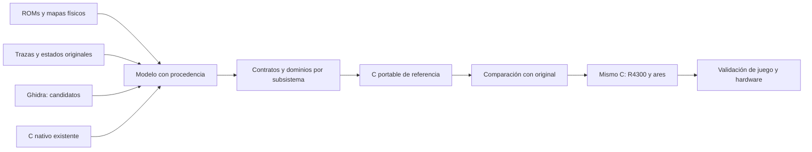

# Estrategia de recuperación completa del programa

El objetivo es un programa C íntegro y compilable que conserve la lógica del
juego y pueda enlazarse para R4300 con libdragon. No se acepta como resultado
un conjunto de salidas Ghidra, una colección de replays o una campaña que use
sustitutos provisionales. Recuperar el C original con sus nombres/comentarios
no es demostrable; recuperar su comportamiento y contratos sí es el objetivo.

## Cambio de unidad de trabajo

La unidad de cierre será un subsistema con todos sus consumidores y datos,
no una rutina pequeña probada aparte. Las rutinas aisladas siguen siendo útiles
como evidencia, pero un subsistema se cierra al ejecutarse integrado sin
inyectar estados intermedios ni dejar servicios alcanzables sin recuperar.
El programa completo requiere además todos los subsistemas y caminos restantes.

Se mantienen tres capas distintas:

1. **Modelo original:** imágenes físicas, ventanas bancadas, vectores, copias de
   código, instrucciones/CFG, datos, imports y ABI originales.
2. **C de referencia:** funciones portables con tipos de ancho fijo, estado
   explícito y servicios de plataforma. Sin fetch/decode de instrucciones CPU.
3. **N64:** esa misma lógica compilada para R4300, unida a backends libdragon,
   RDP, controles, DMA y audio. Pasar una prueba de un módulo no valida el juego.

## Identidad y evidencia

Una ubicación necesita CPU, banco/mapeo, PC de ejecución, fuente física y
versión o vida de la copia. PC solo no distingue cuatro bancos P2, ventanas
Z80 ni código copiado a RAM. No se pueden mezclar esos contextos al crear
funciones o medir cobertura.

Cada unidad tendrá fuentes, entradas/rangos, datos consumidos, dependencias,
registros/flags vivos, restricciones de dominio, evidencia original y prueba
host/MIPS. Se distinguirá candidato, decodificado estáticamente, ejecutado,
comparado, integrado y validado como entrega. Ninguna transición se obtiene
solo cambiando una etiqueta. El primer registro curado es
`decomp/native-components.json`; no pretende contener todos los módulos.

## Hallazgos que cambian la prioridad

El modelo fijo exportado contiene 5.180 funciones candidatas y 30.101 filas de
relaciones, incluidas 5.730 asignaciones candidatas de estado. Su análisis señala
5.243 sitios con posible consumo inmediato de flags escritos por el destino.
Los conjuntos de registros proceden de p-code bruto: **no son ABI ni liveness
ya demostrados**. La identidad de cada llamada se contrasta antes de modificar C.

- 00427A tiene 1.914 llamadores distintos en ese modelo y un borrador automático
  con diagnósticos. Sin embargo, `neo_animation.c` ya implementa un subconjunto
  probado. La acción correcta es completar y reutilizar ese componente.
- 004256 y 01ABC8 muestran la misma necesidad de reconciliar C nativo y modelos.
- El registro inicial no asocia todavía 0040BC/004188 con un componente nativo
  completo; hay que recuperar sus contratos de listas/actores y despacho,
  buscando primero posibles implementaciones aún no registradas.
- El modelo contiene once propietarios candidatos sin entrada en el índice C.
  No se deduce que todos sean código válido ni que las otras raíces basten.
- La tabla de animación tiene **13 stubs BRA.W** en desplazamientos de opcode
  00,04,...,30. El guard compara con 34 hexadecimal: no son 52 comandos.
  El conversor actual de Marco no tiene rama para 2C; 14/30 aún dependen de
  callbacks/servicios parcialmente recuperados. Tener ramas de parser no
  demuestra equivalencia de los comandos ni validez de todos los datos.

## Raíces que faltaban en el modelo fijo

El catálogo `decomp/analysis/program-roots.json` añade evidencia estática:

- Vectores de cartucho apuntan a 0022A2, 0022AC y 002322, sin propietario en el
  modelo almacenado. La selección de vectores BIOS/cartucho es contexto runtime.
- En 001024..001040 se copia un contenedor de 4.426 bytes desde P1:001158 a
  RAM:100000 y se llama a su entrada. El contenedor puede incluir datos internos.
- En 0010DA..0010EA se copia desde P1:0010EE hasta el primer word RTS, 106 bytes,
  a RAM:10FC00 y se salta allí. Una captura existente conserva exactamente
  esos 106 bytes; esa igualdad no demuestra por sí sola su ejecución.

Esto impide tratar el grafo fijo como todos los caminos del programa. Hay que
crear contextos de ejecución para copias/overlays y volver a propagar raíces.
Las copias permanecen como contenedores sin partición interna completa hasta
seguir su código y sus datos; no se marca todo el blob como instrucciones.

## Orden de ejecución

1. **Cerrar el modelo de entrada.** Reconciliar fuentes nativas y candidatos;
   añadir vectores, imports, contextos RAM/P2/Z80; clasificar regiones y
   detectar destinos/callbacks desde tablas y ejecución. La decodificación
   M68020 de Ghidra es un superset; MAME M68000 contrasta las instrucciones.
2. **Cerrar el runtime común.** Asignación/listas/despacho de actores,
   intérpretes de animación y eventos, RNG, escena/padres y colisiones.
   Resolver las salidas en D0..D7/A0..A6/CCR usadas por los llamadores;
   preservar anchuras, wrapping, ASR y orden temporal. Un C void vacío no
   sustituye a una rutina que devuelve flags.
3. **Cerrar lógica y contenido.** Todas las máquinas de estados, armas,
   vehículos, jefes, menús, muerte/continues y dos jugadores, más scripts y
   datos de las seis misiones. Los dominios no observados se revisan de forma
   estática y con ensayos específicos; una partida feliz no cubre el programa.
4. **Cerrar sonido.** Completar M1 y su banca, secuenciación Z80 y contrato
   YM2610/muestras; conectar su equivalente nativo. El mapa inicial no es
   todo el driver ni el C de sonido compilable.
5. **Integrar y comparar.** Una ejecución portable desde arranque hasta final,
   comparada con el original por tick: RNG, actores, eventos, colisiones,
   peticiones de dibujo y audio. Mantener el orden original de actualización;
   no imponer un tick universal de 60 Hz a todos los actores.
6. **Validar N64 y entregar.** Compilar la misma lógica para R4300, ejecutar
   recorridos completos en ares, comprobar memoria/tiempos y hardware. El ZIP
   final lleva fuentes, generadores, mapa y manifiestos reproducibles. No se
   certifica con porcentajes de archivos ni con una demo de una región.

## Criterio de avance

`decomp/recovery-roadmap.json` fija dependencias y puertas de cierre. El grafo
ofrece candidatos de alto impacto; la ejecución original confirma sus contratos.
Se cuentan regiones clasificadas, destinos resueltos, dominios cerrados y
subsistemas integrados frente a una base conocida. El porcentaje de entradas
Ghidra tentativas se retira como indicador de avance del proyecto.
La completitud global sigue siendo desconocida/incompleta mientras falten
raíces, dominios y validación integral. No se crea un nuevo ZIP de entrega.
